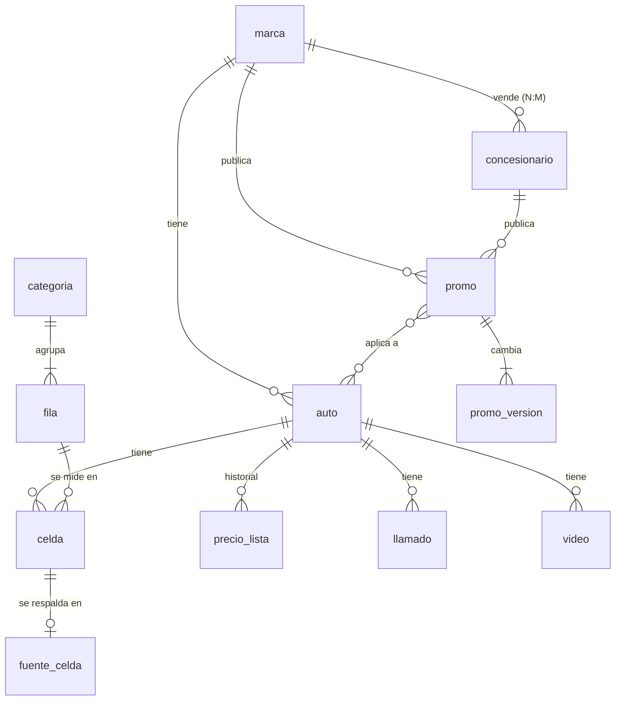

# Modelo de datos de Autolofy (2026-11-04)

Objetivo (pedido de Mati): que **todo dato de Autolofy viva en una base Postgres en Neon** y que el sitio **no pierda velocidad**.
Decisión: la base es la **fuente de verdad** y un paso de build la exporta al `index.html` y a los JSON que ya se sirven. El visitante
sigue bajando archivos estáticos desde el borde de Vercel: **la base no está en el camino de la carga** (cero latencia nueva).
Hasta el 2026-11-04 la fuente de verdad eran los propios `index.html` y `concesionarios.json`.

## Glosario
- **Auto**: una versión concreta de un modelo vendida (o por venderse) en Argentina; es una columna de la tabla comparativa. Su `slug` es `marca-modelo`.
- **Fila / categoría**: una característica comparable («Precio de lista…», «Longitud (mm)») y el grupo al que pertenece.
- **Celda**: el valor de una fila para un auto. Tiene un **origen**: `dato` (confirmado), `nota` (con matiz), `ext` (otro mercado o prensa),
  `det` (confirmado con detalle), `nr` (sin dato, con motivo) o `centinela` (`YES`, `NO`, `OPT`, `ND`).
- **Fuente de celda**: de dónde salió una celda (documento, URL, hash, fecha); registrada celda por celda desde 2026-11-01.
- **Promo**: oferta publicada por una marca (para toda su red) o por un concesionario concreto. **Versión de promo**: cada estado que tuvo.
- **Llamado a revisión**: alerta oficial de Defensa del Consumidor que nombra un modelo.

## Diagrama

## Relaciones y cardinalidad
| Relación | Mín/Máx lado A | Mín/Máx lado B | Puede cambiar | Nota |
|---|---|---|---|---|
| marca → auto | 1/1 | 0/N | no | un auto tiene una sola marca |
| auto × fila → celda | 0/1 | 0/1 | sí | a lo sumo una celda por auto y fila; **no se carga celda 'ND' implícita**: la tabla es completa (265 × 104) |
| celda → fuente_celda | 0/1 | 0/1 | sí | solo las celdas cargadas desde 2026-11-01 |
| auto → precio_lista | 0/N | — | sí, con fecha | uno por moneda y fecha de vigencia |
| concesionario ↔ marca | N/M | N/M | sí | un local puede vender varias marcas |
| promo → autos | 1/N | N/M | sí | `autos` puede ser «todos los de la marca» (`todos_los_autos`) |
| promo → emisor | 1/1 | — | no | exactamente uno: marca **o** concesionario (CHECK) |

## Invariantes
| ID | Regla | Mecanismo |
|---|---|---|
| I1 | Un auto tiene una sola celda por fila | PK (auto, fila) |
| I2 | El origen de una celda es uno de seis | CHECK de lista |
| I3 | `dato` y `centinela` no llevan detalle (los otros cuatro pueden) | CHECK |
| I4 | Un valor visible plano no contiene `|` (regla 6 del CLAUDE.md) | CHECK |
| I5 | Un centinela es exactamente `YES`, `NO`, `OPT` o `ND` | CHECK |
| I6 | Todo texto con `Sí (…)`/`No (…)` va en castellano: no `YES (`, `NO (`, `OPT (`, `ND (` | CHECK |
| I7 | `slug` de un auto = marca-modelo en minúsculas sin espacios | CHECK de formato |
| I8 | Una fuente de celda apunta a una celda existente y su URL es https | FK + CHECK |
| I9 | Un precio es positivo; moneda USD o ARS; una sola fila por (auto, moneda, desde) | CHECK + UNIQUE |
| I10 | Una promo tiene un emisor exacto (marca XOR concesionario) | CHECK |
| I11 | Una promo con vigencia no vence antes de su primera consulta | CHECK en promo_version |
| I12 | Una promo vigente no tiene fecha de retiro; una retirada sí | CHECK |
| I13 | Un llamado tiene fecha, modelo y descripción; `fecha_dudosa` marca la ambigua | NOT NULL + CHECK |
| I14 | Un video tiene id de YouTube único por auto, duración > 0 | UNIQUE + CHECK |
| I15 | El estado de un auto es uno de cuatro | CHECK |

## Máquinas de estado
- **auto.estado**: `venta` ⇄ `preventa` → `venta`; `nolanzado` → `preventa` → `venta`; `venta` → `discontinuado` (terminal, pero reversible si vuelve; no se fuerza).
- **promo.estado**: `vigente` → `retirada` → (puede volver a `vigente`: se reabre `retirada_el = NULL`).

## Tiempo e histórico
- **Precios**: cada precio con `desde`; la primera entrada de cada auto es la línea base (`desde` NULL = «valor al empezar el historial»).
- **Promos**: `promo_version` guarda cada estado con la fecha desde la que rige; `primera_vez`/`ultima_vez`/`retirada_el` en `promo`.
- **Celdas**: hoy solo el valor vigente (+ fuente con fecha). El historial de celdas sale del git; **fuera de alcance de la etapa 1**.

## Etapas
1. **Etapa 1 (esta)**: marca, auto, categoría, fila, celda, fuente_celda, precio_lista (con el historial en dólares), precio_historial (todas las monedas),
   concesionario, promo y promo_version, llamado, video, venta_marca. Carga, exportador y prueba de ida y vuelta.
2. **Etapa 2** (hecha el 2026-11-05, `schema-etapa2.sql`, `cargar2.mjs`, `exportar2.mjs`): colores (con su muestra), fotos (vista y crédito), fotos descartadas, logos, service oficial (marca, auto y cada visita), gastos para patentarlo (lo nacional y las 24 jurisdicciones) y tasas del BCRA. La prueba de ida y vuelta compara cada constante con la de `index.html`. **Etapa 2b** (2026-11-05, `schema-etapa2b.sql`): `foto_fuente` (una fila por archivo de `fotos-fuentes.tsv`) y las tres clases de fila de `fichas-fuentes.tsv`: `ficha_fuente` (auto, archivo, url, verificación, fecha; `sha256` solo si la verificación es un hash), `portada_commons` y `portada_oficial` (2 o 3 campos). Cada una lleva `linea` para reconstruir el orden del archivo y `auto_slug` si el nombre es el de un auto (hay fuentes de marca como «Chery (precios)» y un nombre viejo, «Corolla Cross HEV», que quedan sin slug). **Queda afuera a propósito** `RED_OFICIAL`, que es **derivado** de `concesionarios.json` y no se guarda.
3. **Etapa 3** (hecha el 2026-11-05 en su primera mitad): `sincronizar.mjs` pone la base al día desde el repo y la verifica contra Neon; la rutina lo corre al final. **Falta** invertir la dirección (la rutina escribe en la base y un build regenera `index.html`): requiere exportar el texto de cada constante byte a byte, hoy solo se reproduce su estructura.
Los textos de interfaz (`GLOSSARY`, `ELEGIR_*`, etiquetas cortas) **se quedan en el código**: no son datos del mundo.

## Supuestos
- La base nueva es un proyecto de Neon propio `autolofy` (como `mensajeria`), nunca `neondb` de propiedades.
- El sitio **no lee la base en tiempo de carga**; la exporta un build (decisión por latencia: un viaje a Neon suma 100 a 400 ms con la base dormida).
- Las celdas se guardan **partidas** (origen, valor, detalle) para poder consultarlas, y el exportador las recompone **idénticas** a `DATA`.
